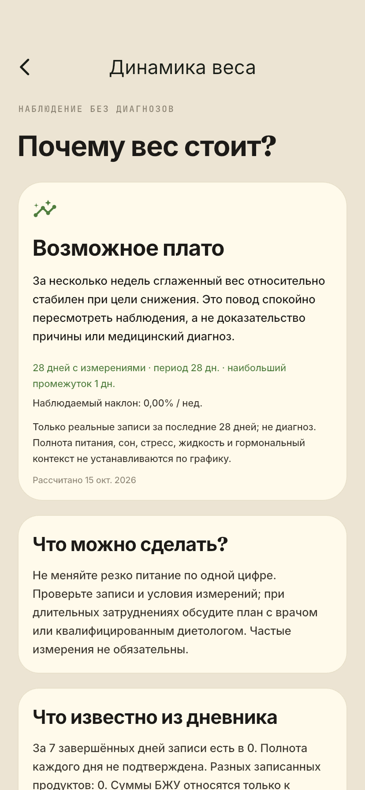
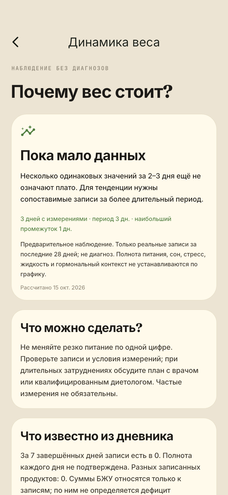
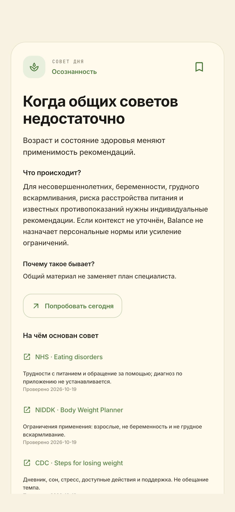
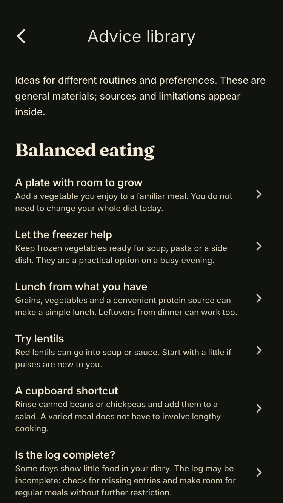

# Проверки Daily Tips и анализа веса — build 21

Дата: 20.10.2026. Flutter/iOS проект Balance, production target `lib/main.dart`.

## Автоматические проверки

| Проверка | Результат |
|---|---|
| `flutter analyze --no-pub` | Без замечаний |
| `flutter test --no-pub` | **417 passed**, включая unit, widget и golden tests |
| Целевые `tips_insights_integration_test.dart`, `weight_trend_insights_test.dart` | **30 passed** |
| `weight_trend_insights_test.dart`, `daily_tips_service_test.dart` с `TZ=Pacific/Kiritimati` | **39 passed** |
| Те же тесты с `TZ=America/Los_Angeles` | **39 passed** |
| Проверка совместимости через AppDataProvider на защищённой копии build 20 | PASS; протокол и данные вне репозитория |
| Hive | Существующие значения/записи, избранное, история, профиль и достижения сохранены |
| SQLite | Три базы побайтно идентичны эталону; `quick_check=ok` |
| Оригинал контрольного контейнера | Повторная SHA-256 проверка всех файлов; изменений нет |
| Подписанная `flutter build ios --release --no-pub --target lib/main.dart --build-number=21 --dart-define=BALANCE_APP_VERSION=1.0.0+21` | PASS, **38,9 MB** |
| `codesign --verify --deep --strict` | PASS для результата сборки и отдельного кандидата |
| Bundle ID / application identity / Keychain | Совпадают с build 20, версия **1.0.0+21** |
| Профиль подписи | Действует до **22.10.2026 13:46 UTC**; для установки позже потребуется обновление подписи |
| Физический iPhone | Не устанавливалось; требуется отдельное согласие и свежие проверки |
| `git diff --check` | PASS |

Полный набор включает обновлённые 18 тестов визуальных эталонов и проверки существующих графиков, прогнозов, дневника, локального каталога и резервного копирования. Эталоны изменены только там, где ожидаемо поменялись карточка/статья советов и вход в анализ динамики.

## Сценарии

- Нет записей; 2 одинаковых взвешивания; 3 и 6 дней; стабильные 7–13 и 14–20 дней; плотные 21–28 дней; большая история, ограничиваемая текущими 28 днями.
- Сортировка фактических дат, медиана нескольких показаний за день, повторяющиеся и конфликтующие ID, NaN/неправдоподобные данные, будущие дни, пропуски и устаревшие показания.
- Снижение, рост, колебания и развороты; нормирование для 50/80/140 кг; граничные наклоны, плотная и нерегулярная история. Результаты подтверждают реализацию порогов, а не клиническую точность.
- Достигнутая цель, поддержание, смена цели; неизвестный/несовершеннолетний возраст; беременность, лактация, риск РПП и медицинские ограничения; неполное подтверждение безопасности.
- Неполный/низкий дневник, отсутствие еды/шагов/БЖУ; макросовет только при реальных суммах и разных продуктах; зарегистрированные калории не означают доказанный дефицит.
- Старые ID, 180 сохранений/отметок, перезапуск, импорт/восстановление, изменение и удаление измерений; сохранение из библиотеки без ложного назначения; источник неизвестного ID исключён из ротации.
- Ротация 500 дней, текущая дата, язык, смена месяца, местная/UTC форма одного момента, восточный/западный часовой пояс; ошибки записи и последующая попытка.
- Widget tests проверяют RU/EN, light/dark, ширины 320/414/430, увеличенный до 200% текст, Reduce Motion, новые страницы и старые действия.

## Визуальная проверка

Синтетические данные размещены во временном отдельном Hive-каталоге. Контейнер пользователя не используется. Числа и дата 15.10.2026 на изображениях принадлежат фиксированному сценарию, а не данным телефона.

Матрица: iPhone 11, iPhone SE 3, iPhone 16 Pro Max × RU/EN × light/dark × 7 экранов (главная карточка, подробный совет, источники/контекст, возможное плато, ограничения дневника, три дня, библиотека). Полная матрица содержит 84 PNG; перечень и контрольные суммы находятся в локальном протоколе визуальной проверки. В Git включены только несколько синтетических примеров ниже.

Независимая клиническая редактура RU/EN и калибровка на реальной выборке остаются незавершёнными: [границы доказательств](DAILY_TIPS_EVIDENCE.md). Физическая установка и проверка текущей версии непосредственно на телефоне в этот этап не входят; требуется отдельное согласие.

### Примеры интерфейса

| iPhone 11: возможное плато | iPhone 11: три дня — мало данных |
|---|---|
|  |  |

| Большой iPhone: статья | SE: библиотека EN, тёмная тема |
|---|---|
|  |  |

[Источники RU](screenshots/daily-tips-v3/iphone11-ru-sources.png) · [Ограничения EN](screenshots/daily-tips-v3/iphone-large-en-context.png)
