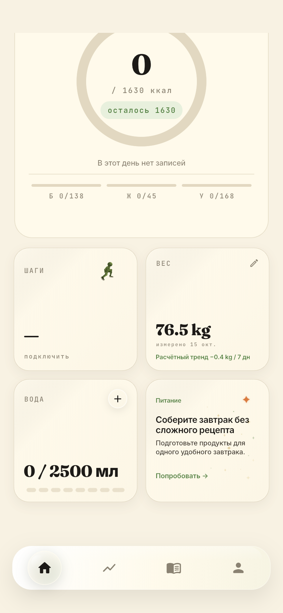
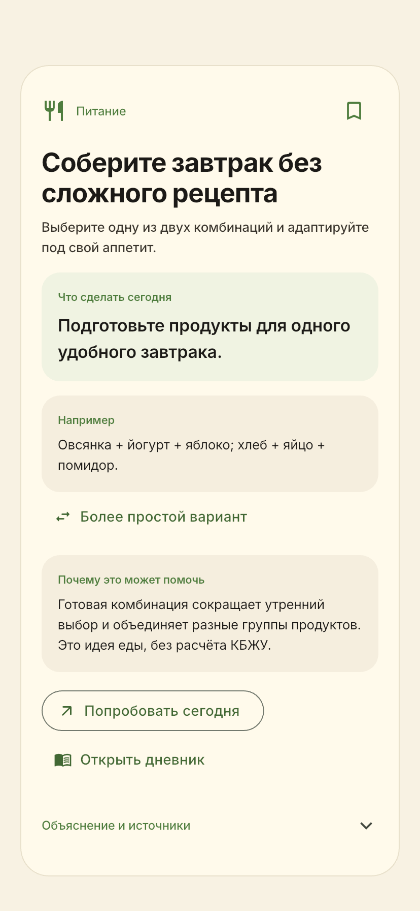
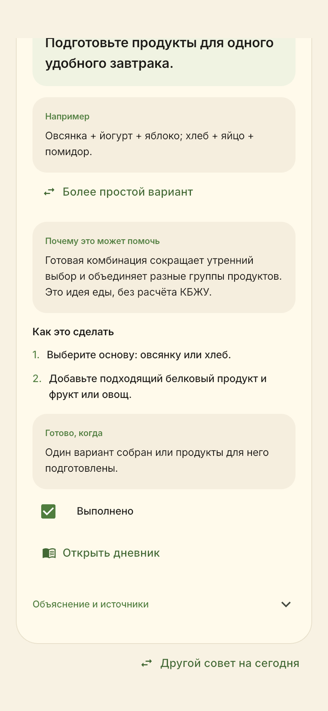
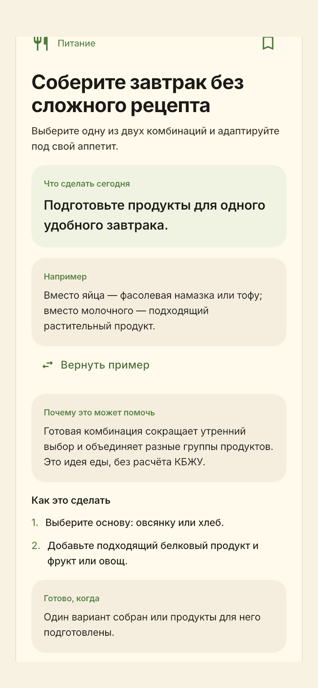
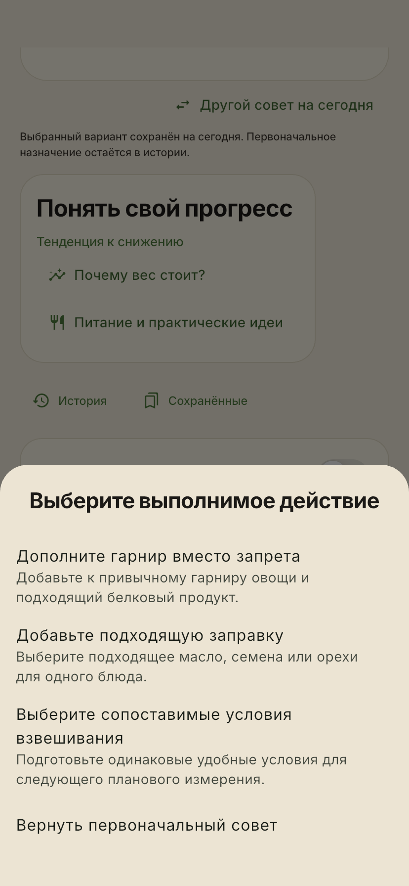
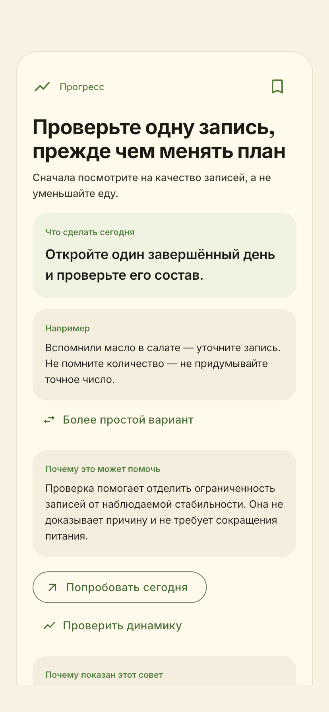

# Проверки Daily Tips 3.1 — build 23

20.10.2026. Итоговые результаты после исправления ротации и проверки совместимости.

| Проверка | Фактический результат |
|---|---|
| `flutter analyze --no-pub` | **PASS, No issues found** |
| Полный `flutter test --no-pub` | **PASS, 448 тестов**, включая 14 новых проверок расширения |
| Целевой набор service/actions/expansion | **PASS, 42 теста** |
| Активные / универсальные / контекстные | **150 / 137 / 13**; 95 новых, 5 дублей выведено |
| Проверка RU/EN | Все 150 пар: действия, 2–3 шага, примеры, альтернативы, критерии и ограничения; поштучный авторский семантический аудит |
| Похожие действия | 18 проверенных групп; **127 тем**, из них **119 универсальных** |
| Реальные фильтры / неполный дневник | **137 универсальных** для каждого из 7 профилей безопасности; отсутствующие сигналы не выдумываются |
| Реальный каталог / 60-дневное окно | Два прогона по **500 дней**, персонализация off/on с неполными данными: нет повторов ID и тем внутри окна; смена категории при допустимом варианте; охват универсальных планов и стабильность перезапусков |
| Ограниченный пул | 3 плана / 70 дней: конечный fallback, честный размер доступного пула и отсутствие соседнего повтора |
| Совместимость build 22 | Все **200 старых ID** сохраняют обе локализации и версию; 5 выведенных планов сохраняют задания, причины, альтернативы, избранное и выполнения после двух перезапусков без записей в Hive |
| Машинный каталог | Полное соответствие исполняемому каталогу; проверка локализаций, источников и правил применимости |
| Визуальные эталоны | Все прежние тесты проходят. Назначение build 22 закреплено в фикстуре; один эталон обновлён для уведомления архивного плана |
| iOS release | **PASS, 39.2 MB**, `lib/main.dart`, `1.0.0+23`; автоматическая подпись Xcode |
| Проверка подписи | **PASS**, `codesign --verify --deep --strict`; `CFBundleVersion=23` |
| Физический iPhone | **Не устанавливалось** |

Логи итогового прогона сохранены локально и в Git не включены. Личные данные и исходные резервные копии не открывались. Клиническая проверка эвристик возможного плато и независимая двуязычная редакторская экспертиза остаются незавершёнными. [Отчёт 3.1](DAILY_TIPS_31_REPORT.md), [семантический аудит](DAILY_TIPS_31_AUDIT.md).

## Архив: Daily Tips 3.0 — build 22

20.10.2026. Результат: практические планы, явный выбор альтернатив и независимые отметки выполнения.

| Проверка | Результат |
|---|---|
| `flutter analyze --no-pub` | **No issues found** |
| `flutter test --no-pub` | **434 passed** |
| Финальные целевые `daily_tips_actions_test.dart` + `daily_tips_widget_test.dart` | **30 passed** |
| Контент | 80 прежних статей проверены; 60 планов RU/EN, 20 объединены, 200 ID разрешаются |
| Предметные проверки текстов | Применимые примеры и ограничения каждой категории; уникальные действия, примеры и объяснения; не проверка по одному глаголу |
| Визуальные эталоны | 18 прежних reference cases и 3 новых эталона практических планов проходят в полном наборе |
| Совместимость Hive/backup | Исходное назначение, выбранный вариант, сохранения и раздельное выполнение переживают экспорт/восстановление и повторное открытие |
| Большой пул ротации | 500 дней, цикл и исключение 60 дней при достаточном допустимом пуле |
| Текущая сокращённая библиотека | 500 дней без соседних повторов ID и тематической группы; показ всех допустимых универсальных планов |
| Доступность | 320/414/430, RU/EN, light/dark, 200% текста, Reduce Motion, настоящие шрифты; масштаб применяется и к новым маршрутам |
| Главная при 200% | Нет переполнения; действие и кнопка доступны; подписи кольца вписываются в графическую область |
| Release `lib/main.dart`, build number 22, `BALANCE_APP_VERSION=1.0.0+22` | **PASS, 39,0 MB** |
| Строгая подпись сборки и отдельного кандидата | `codesign --verify --deep --strict`: **PASS** |
| Bundle/application identity/Keychain | Совместимы с build 21; сертификат включён в профиль |
| Профиль | Действует до **22.10.2026 13:46 UTC**; более поздняя установка требует новой подписи |
| Физический iPhone | **Не устанавливалось** |

## Проверенные сценарии

- Одно понятное действие видно до раскрытия статьи; реальные примеры, доступные замены, два-три шага и критерий завершения.
- Явный выбор из предложенных вариантов и библиотеки; исходный ID стабилен. Показ, сохранение, выбор и открытие дневника не отмечают задачу выполненной.
- У каждого выбранного варианта отдельное выполнение. Возврат к оригиналу, перезапуск и возвращение на прежнюю дату сохраняют выбор/отметки. Запись не меняет вчерашнее назначение при переходе через полночь.
- Ошибка сохранения не меняет выбор в памяти, повторная попытка работает. Некорректные вложенные варианты не подменяют исходный ID.
- Старая версия выполнения сохраняется; новое явное выполнение записывает актуальную версию действия без переписывания первоначального контекста. Небезопасный старый план не передаёт свою отметку общей поддержке.
- Контекст повторов только по нескольким завершённым дням и реальным записям; сегодня не считается завершённым периодом. Нет выдуманной полноты, дефицита, привычки или нулевых шагов. NaN БЖУ не допускает макросовет.
- Чтение источников и полных планов на новых маршрутах, выбор альтернативы с английским текстом 200%, сохранение из библиотеки без ложной истории.
- Переход в рабочий дневник и реальные графики не создаёт еду/измерения и не меняет выбранную дату сам по себе.
- Прежние сценарии недостатка данных, трёх дней, стабильных недель, колебаний, достигнутой цели, неизвестного/несовершеннолетнего возраста и иных защитных ограничений сохранены.
- Полный набор также проверяет прежние дневник, вес, обхваты, прогноз/кэш, графики, воду, поиск продуктов, рецепты, достижения и резервное копирование.

Личные записи и исходные резервные копии не использовались и не изменялись. Hive-тесты и визуальные сценарии работают только с синтетическими данными в отдельном временном хранилище. Сведения о подписи и бинарный кандидат остаются вне Git.

## Реальные снимки симуляторов

**64 новых PNG**, iOS 18.6. iPhone 11: RU/EN × light/dark × 8 состояний. iPhone SE 3 и iPhone 16 Pro Max: RU/light и EN/dark × 8 состояний. На iPhone 11 проверена полная матрица языка/темы; на остальных — парные комбинации двух языков и двух тем. Подписи/CRC PNG, размеры и SHA-256 записаны в локальном manifest; ошибок рендера в логах capture нет.

Состояния: главная, действие/пример, шаги и явное выполнение, замена, выбор другого совета, план при возможном плато, анализ реальных измерений, библиотека. Фиксированные даты и значения на снимках — сценарий, а не сведения телефона.

| Главная: конкретная задача | Полный план: действие и пример |
|---|---|
|  |  |

| Шаги и самостоятельная отметка | Понятная замена |
|---|---|
|  |  |

| Выбор другого действия | Первое действие при стабильности веса |
|---|---|
|  |  |

[SE: английский, тёмная тема](screenshots/daily-tips-actions/se-action-en-dark.png) · [Большой iPhone: анализ EN/dark](screenshots/daily-tips-actions/large-insights-en-dark.png)

## Пределы проверки

Тесты проверяют код, совместимость и наблюдаемое поведение, а не эффективность каждого совета для каждого человека. Примеры еды не содержат вымышленных точных КБЖУ. При 47 универсальных планах строгий интервал повторов 60 дней невозможен; используется тематический/категорийный fallback. Чекбокс — самоотметка человека.

Независимая клиническая редактура и калибровка численных порогов плато остаются незавершёнными: [границы источников](DAILY_TIPS_EVIDENCE.md). Перед будущим обновлением телефона обязательны отдельное согласие, свежая резервная копия и повторная проверка устройства и подписи.

Базовый этап build 21 имел 417 успешных тестов; его протокол сохранён в [истории репозитория](https://github.com/unxry/balance/blob/50f44ac1f144b14830972c1abd547dde063041c7/docs/TEST_RESULTS.md).
